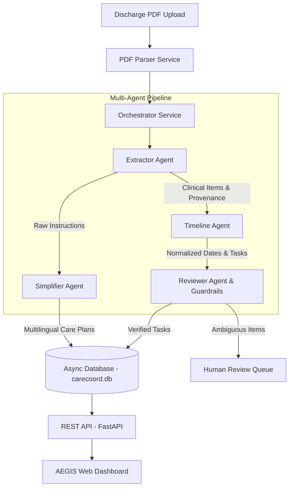

# A.E.G.I.S — Agentic Hospital Discharge & Follow-up Coordinator

<div align="center">

**Care that Continues**  
*Turning dense medical discharge summaries into clear, chronological, actionable recovery plans.*

[](https://react.dev/)
[](https://fastapi.tiangolo.com/)
[](https://www.sqlite.org/)
[](#)

</div>

---

> [!IMPORTANT]
> **Clinical Safety & Non-Diagnostic Disclaimer**:  
> AEGIS is an organizational care coordination tool designed for patients, family caregivers, and clinical coordinators. **It does NOT provide medical advice, diagnose medical conditions, alter prescribed medications, or change dosages.** All extracted instructions reproduce verified source text with page-level citations. Any ambiguous phrasing (e.g., *"take as directed"*, *"PRN as needed"*, missing follow-up dates) is flagged under patient safety protocols and escalated to a licensed clinician via the **Human Review Queue**.

---

## 🌟 Executive Overview

Hospital discharge summaries are notoriously dense, jargon-heavy, and difficult for patients to navigate. Critical recovery actions—such as staple removal visits, blood tests, physical therapy referrals, and high-risk warning signs—are often buried across multiple pages of unstructured text.

**AEGIS** bridges the transition of care gap by introducing an autonomous, multi-agent AI pipeline that:
1. **Parses & Extracts**: Identifies appointments, diagnostic tests, specialist referrals, medications, and self-care protocols from any hospital discharge PDF.
2. **Sequences into Timelines**: Converts relative timeframes (*"in 7 days"*, *"twice weekly for 3 weeks"*) into standardized, chronological ISO due dates.
3. **Translates & Simplifies**: Explains medical jargon at a 6th-grade reading level in **English**, **Hindi (हिन्दी)**, and **Tamil (தமிழ்)** without altering clinical instructions.
4. **Enforces Strict Safety Guardrails**: Calibrated confidence scoring (80%–90%) ensures unverified or ambiguous instructions cannot be marked complete without clinician sign-off.
5. **Provides Complete Provenance**: Every task and instruction links directly to its source document page and exact quote.

---

## 🏗️ Multi-Agent Architecture



### Specialized Agents

- **Extractor Agent (`extractor_agent.py`)**: Multi-pattern clinical regex and layout engine. Extracts patient names, discharge dates, diagnoses, appointments, laboratory tests, specialist referrals, medications, care instructions, and warning signs with exact page and quote citations.
- **Timeline Agent (`timeline_agent.py`)**: Natural language date normalizer. Parses expressions like *"in 14 days"*, *"on 19 October 2026"*, and *"twice weekly"* relative to the discharge date into discrete chronological tasks.
- **Simplifier Agent (`simplifier_agent.py`)**: Jargon-to-plain-language translator. Converts complex medical terms (e.g., *NPO*, *ambulation*, *erythema*, *subcutaneous*) into clear, patient-friendly guidance across English, Hindi, and Tamil.
- **Reviewer Agent (`reviewer_agent.py`)**: Safety triage engine. Scans every extracted directive against clinical guardrails. Flags non-specific frequencies (*"take as previously directed"*), missing timings, or drug warnings for manual clinical verification.
- **Provider Agent (`provider_agent.py`)**: Fuzzy matching directory that matches follow-up directives to in-network clinic locations, specialties, and accepted insurances.

---

## 🚀 Key Features

| Feature | Description |
| :--- | :--- |
| **Instant PDF Analysis** | Upload any discharge summary and watch real-time multi-agent processing steps with dynamic progress indicators. |
| **Dynamic Patient Header** | Instantly displays the extracted patient name (*e.g., Eleanor Chen, Riley Thompson, Margaret K. Higgins*) and discharge date right at the top. |
| **Dual Role-Based Portals** | Distinct entry points for **Patient** and **Doctor/Clinician** with role-tailored route protection and navigation. |
| **Actionable Dashboard** | High-level metrics: Total Actions, Pending Tasks, Completed Items, and Needs Review alerts. |
| **Interactive Care Timeline** | Chronological milestone tracker with overdue/upcoming tags and category badges. |
| **Task Management & Persistence** | Complete tasks, track actions across sessions, and sync state persistently across the entire app. |
| **Traceability & Citations** | Click any action or medication to inspect the source citation showing the exact document page and verbatim text quote. |
| **Doctor-Only Human Review Queue** | Clinician triage portal to review, comment on, and resolve flagged ambiguities; approved actions automatically update dashboard metrics. |
| **Provider Directory Finder** | Search and locate primary care providers, orthopedic surgeons, cardiologists, and physical therapy centers. |
| **Multilingual Support** | Seamless toggle between English, Hindi, and Tamil for discharge guidance. |
| **Premium Dark Glassmorphism** | Built with Tailwind CSS, sleek dark tones (`#000000`, `rgba(14, 14, 16, 0.95)`), custom Outfit/Inter typography, and subtle micro-animations. |

---

## 👥 Role-Based Authentication & Portals

AEGIS includes a dual-portal architecture separating patient self-care from clinical verification:

| Portal | Route | Demo Credentials | Capabilities & Permissions |
| :--- | :--- | :--- | :--- |
| **Patient Portal** | `/login/patient` | `demo@acentra.health`<br>`Acentra@2026` | Patient Overview, Care Timeline, Action Tasks, Care Instructions, Medications, Warning Signs, Source Citations, Provider Directory. (Cannot access or approve clinical review cases). |
| **Doctor Portal** | `/login/doctor` | `doctor@aegis.health`<br>`Aegis@2026` | Complete clinical access: All patient views **plus** the **Human Review Queue** (`/reviews`) to inspect flagged ambiguities, add clinician resolution notes, and approve actions for patients. |

*Quick Portal Switcher*: Access `/role-select` to choose either the Patient or Doctor portal.


---

## 📁 Repository Structure

```text
ACENTRA FINAL/
├── backend/                             # FastAPI Backend Service
│   ├── app/
│   │   ├── api/v1/endpoints/            # API Endpoints (discharge, patients, tasks, reviews, providers)
│   │   ├── agents/                      # Multi-Agent Coordination (Extractor, Timeline, Simplifier, Reviewer, Provider)
│   │   ├── core/                        # Settings, configuration, and clinical guardrails
│   │   ├── db/                          # SQLAlchemy models & SQLite async session
│   │   ├── schemas/                     # Pydantic v2 validation schemas
│   │   └── services/                    # Orchestrator, PDF parser, and synthetic seeder
│   ├── synthetic_data/                  # Test synthetic discharge PDFs
│   │   └── discharge_summaries/         # Benchmark samples (simple, medium, complex, test cases)
│   ├── carecoord.db                     # SQLite database instance
│   └── tests/                           # Backend automated test suite
│
├── frontend/                            # React 19 + Vite Web Application
│   ├── src/
│   │   ├── components/                  # Reusable UI components (dashboard, tasks, safety, layout)
│   │   ├── context/                     # AppContext (patient state, language) & TaskContext
│   │   ├── pages/                       # Route views (Home, Upload, Processing, Dashboard, Timeline, Tasks, etc.)
│   │   ├── services/                    # Real FastAPI client + resilient mock fallback layer
│   │   └── styles/                      # Tailwind CSS & glassmorphic design system
│   ├── package.json                     # Frontend dependencies and build scripts
│   └── vite.config.js                   # Vite configuration with proxy to FastAPI
│
├── docs/                                # Project Specifications & Architecture Design Docs
│   ├── DESIGN_SYSTEM.md                 # Color palette, glassmorphism tokens, typography
│   ├── ROUTES.md                        # Route tree and deep-link safety guidelines
│   ├── UI_ARCHITECTURE.md               # Frontend state synchronization patterns
│   └── MOCK_DATA.md                     # Data schemas and clinical benchmark models
│
└── README.md                            # Project documentation (this file)
```

---

## 🛠️ Tech Stack

### Frontend
- **Framework**: React 19 + Vite 8
- **Styling**: Tailwind CSS + Vanilla CSS Variables (Glassmorphism, Dark Mode)
- **Icons**: Lucide React
- **Routing**: React Router DOM v6
- **Architecture**: Modular Component-Driven Architecture with Context API (`AppContext`, `TaskContext`)

### Backend
- **Framework**: FastAPI (Python 3.11+)
- **ORM / Database**: SQLAlchemy (Async) + aiosqlite + SQLite
- **Validation**: Pydantic v2
- **Document Processing**: PyPDF / PDFMiner text extraction
- **Server**: Uvicorn with ASGI reload

---

## ⚡ Quick Start Guide

### Prerequisites
- **Node.js** (v18.0.0 or higher) and `npm`
- **Python** (v3.10 or higher) and `pip`

---

### 1. Backend Setup

Open a terminal and navigate to the `backend/` directory:

```bash
cd backend

# Create and activate a virtual environment (optional but recommended)
python3 -m venv venv
source venv/bin/activate  # On Windows: venv\Scripts\activate

# Install dependencies
pip install -r requirements.txt  # or: pip install fastapi uvicorn sqlalchemy aiosqlite pydantic pydantic-settings pypdf python-multipart

# Start the FastAPI development server
python -m uvicorn app.main:app --reload --port 8000
```

The backend will start at:
- **API Base URL**: `http://127.0.0.1:8000/api`
- **Interactive OpenAPI Docs (Swagger UI)**: `http://127.0.0.1:8000/docs`
- **Health Check**: `http://127.0.0.1:8000/health`

---

### 2. Frontend Setup

In a new terminal window, navigate to the `frontend/` directory (note: scripts must be executed inside `frontend/`):

```bash
cd frontend

# Install dependencies
npm install

# Start the Vite development server
npm run dev
```

The frontend application will launch at:
- **Application URL**: `http://localhost:5173` (or `http://localhost:5174` if 5173 is in use)
- **Role Portal Selection**: `http://localhost:5173/role-select`


---

## 🧪 Testing with Sample Documents

Synthetic benchmark PDFs are included in `backend/synthetic_data/discharge_summaries/`:

1. **`01_one_action.pdf`**: Minimal test case (*Expected: 1 primary care appointment*).
2. **`05_nine_actions.pdf`**: High-volume follow-up plan (*Expected: 9 discrete actions across appointments, tests, referrals, and care instructions*).
3. **`09_frequency_duration_details.pdf`**: Explicit dosage and duration case (*Expected: 5 actionable items for patient Riley Thompson*).
4. **`sample_2_medium.pdf`**: Surgical orthopedic case (*Expected: Eleanor Chen, Lovenox regimen, staple removal, PT intake*).
5. **`sample_3_complex.pdf`**: Multi-morbidity escalation case (*Margaret K. Higgins, cardiology review, nephrology consult, safety escalation*).

To test, simply navigate to **Upload Summary** (`/upload`), drag-and-drop any sample PDF, and click **Analyze Summary**.

---

## 📡 API Reference

### Discharge Documents & Pipeline
- `POST /api/discharge/upload` — Upload PDF discharge summary and start async multi-agent pipeline.
- `GET /api/discharge/{id}` — Retrieve document processing metadata.
- `GET /api/discharge/{id}/status` — Poll current extraction progress and stage statuses.

### Patients & Care Plans
- `GET /api/patients/{id}` — Retrieve patient demographic summary and discharge metadata.
- `GET /api/patients/{id}/plan?lang=en` — Get complete simplified care plan (supports `lang=en`, `lang=hi`, `lang=ta`).
- `GET /api/patients/{id}/tasks` — List all actionable tasks filtered by status or category.
- `PATCH /api/patients/{id}/tasks/{task_id}` — Update task status (`Pending` ➔ `Completed`).

### Human Review & Triage
- `GET /api/reviews/cases` — Retrieve all open ambiguous directives awaiting clinician review.
- `PATCH /api/reviews/cases/{case_id}/resolve` — Clinician resolution with clarification notes.

### Provider Directory
- `GET /api/providers/search?specialty=...` — Search in-network clinics and specialists.

---

## 🔒 Clinical Safety Principles

1. **Never Invent Medical Advice**: The system only displays what is explicitly cited in the original discharge summary.
2. **Visual Distinction**: AI-simplified guidance is clearly badged alongside the verbatim clinical quote.
3. **Restricted Completions**: Ambiguous tasks flagged with `"Needs Review"` cannot be dismissed or completed until reviewed by a qualified healthcare professional.
4. **Emergency Red Flags**: Emergency warning signs (e.g., chest pain, high fever, wound dehiscence) are prioritized in prominent alert cards with direct emergency call disclaimers.

---

## 📄 License

This project is licensed under the MIT License for demonstration and evaluation purposes. All patient data, case IDs, and medical facilities used in this repository are **entirely synthetic** and generated for software testing and hackathon evaluation.
